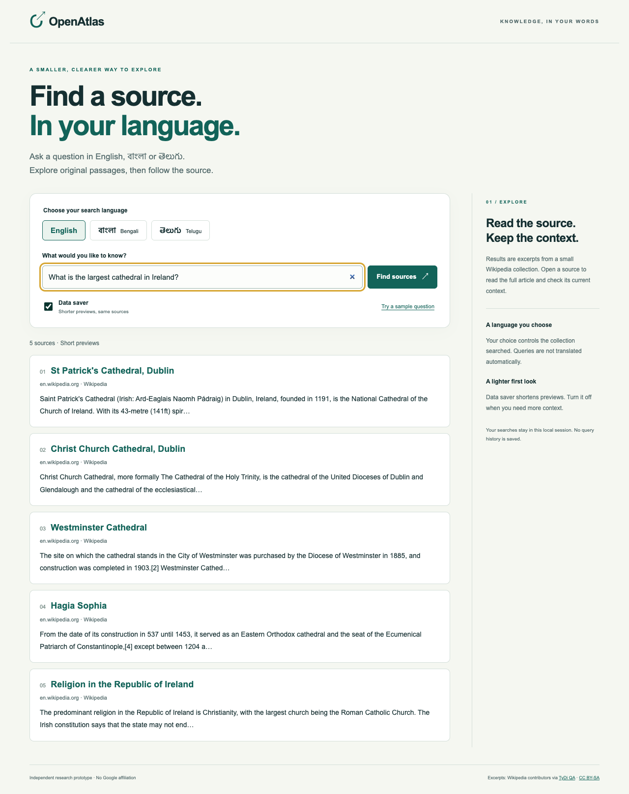

# OpenAtlas — Multilingual Search & Launch Evaluation

**Find a source in your language, with a lighter first look.**

OpenAtlas is a working browser prototype for English, Bengali and Telugu information discovery.
It combines explicit language choice, source-linked passages, a data-saver view and an evaluation that
checks each language before recommending a pilot. It is an independent project, with no Google affiliation.



## The product decision

An aggregate retrieval gain is insufficient if a language gets worse. A character/word retrieval blend,
chosen on 450 validation queries, improved equal-language macro Recall@5 from **76.5% to 86.3%** on
**1,222 held-out queries** over **3,931 passages**. Each language improved, but a substantial gap remains:

| Language | Word baseline Recall@5 | Selected blend Recall@5 |
|---|---:|---:|
| English | 88.0% | 92.5% |
| Bengali | 69.9% | 91.2% |
| Telugu | 71.7% | 75.2% |

These numbers measure retrieval of a known relevant passage in a **derived closed-corpus task using
TyDiQA-GoldP data**, not Google's official question-answering task, open-web quality or customer adoption.
The smaller Bengali evaluation set has 113 queries; Telugu has 669 and English 440.

Compact previews preserve ranked source links while reducing paired UTF-8 JSON response size by
**39.8% on average** (35.0% after gzip). This is a measured payload difference, not a measured mobile-speed
or usability improvement. Users can expand previews; the shorter excerpts need comprehension testing.

**Decision:** a moderated pilot is justified by the offline comparison. A broad launch is not.
Prioritize Telugu error analysis and native-reader usability before expansion. See the
[evaluation and decision](reports/decision.md), [predeclared comparison plan](docs/evaluation-plan.md),
[all query ranks](reports/predictions.csv) and [payload measurements](reports/payloads.csv).

## Run the product

Python 3.12 is the validated runtime. Run from this repository:

```sh
python3 -m venv .venv
source .venv/bin/activate
pip install -e '.[dev]'
python -m openatlas evaluate
python -m openatlas serve
```

Open **http://127.0.0.1:8765**. Choose a language and use a sample question, or ask your own question
within this small collection. No API key, paid provider, login or external model service is needed.
Evaluation downloads about 29 MB of public, revision-pinned Parquet data and checks file hashes.
Raw data and the locally generated index are excluded from Git. Only load trusted local joblib files.

```sh
pytest -q
ruff check openatlas tests
python -m playwright install chromium
python tests/browser_check.py
```

The browser check exercises all three scripts, keyboard submission, mobile layout, preview expansion,
empty results and markup handling. [Browser checks](reports/browser_checks.json) are functional checks,
not native-reader usability research or an accessibility certification.

## Implementation choices

- Unicode-aware word tokens preserve Indic combining marks. Character n-grams handle some surface-form
  variation without a remote translation or model dependency.
- Searchable passages are indexed; query text and answer annotations are never indexed. Official training
  articles/questions overlapping the development set are removed from selection data.
- A single retrieval weight is selected using validation macro Recall@5 with a per-language regression
  guardrail. The held-out evaluation never chooses the weight.
- Feature-frequency ties and score ties use deterministic ordering. CI requires regenerated query ranks,
  response sizes, corpus IDs and selection records to match the committed evidence exactly.
- The UI uses semantic form controls, keyboard focus states, language tags, live status messages and
  `textContent` for result rendering. No analytics or raw-query logging is enabled.
- Every result links to its Wikipedia source. Excerpts come from an older dataset snapshot and may be
  incomplete or stale; no generated answers are presented.

[Product brief](docs/product-brief.md) · [Decisions](docs/decisions.md) · [Research and launch plan](docs/launch-plan.md)

## Data attribution and limits

Data: [Google Research TyDi QA](https://github.com/google-research-datasets/tydiqa), Clark et al. (2020),
*TyDi QA: A Benchmark for Information-Seeking Question Answering in Typologically Diverse Languages*.
[Paper](https://aclanthology.org/2020.tacl-1.30/). This project uses the GoldP secondary-task mirror at
[Hugging Face](https://huggingface.co/datasets/google-research-datasets/tydiqa), revision
`da78f23f9119363459acbaf46bf89426ff26c259`; file URLs and SHA-256 hashes are in
[provenance](data/provenance.json). The original storage download returned 403 during implementation.

The mirror declares Apache 2.0. Underlying Wikipedia text retains its original attribution/share-alike
terms; see [NOTICE](NOTICE). Project code is MIT licensed. No raw corpus is republished here.

This is same-language lexical retrieval in a bounded collection. Translation, transliteration,
code-switching, answer extraction, relevance beyond the known label, live search freshness and
production-scale deployment are untested. No user interviews, field trials or growth metrics are claimed.

Initial implementation: November 2026.
